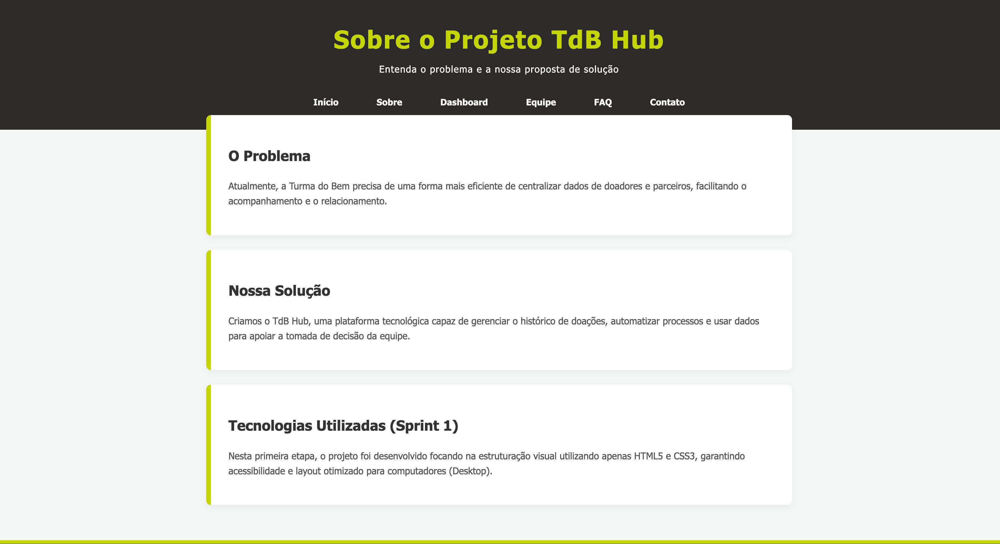
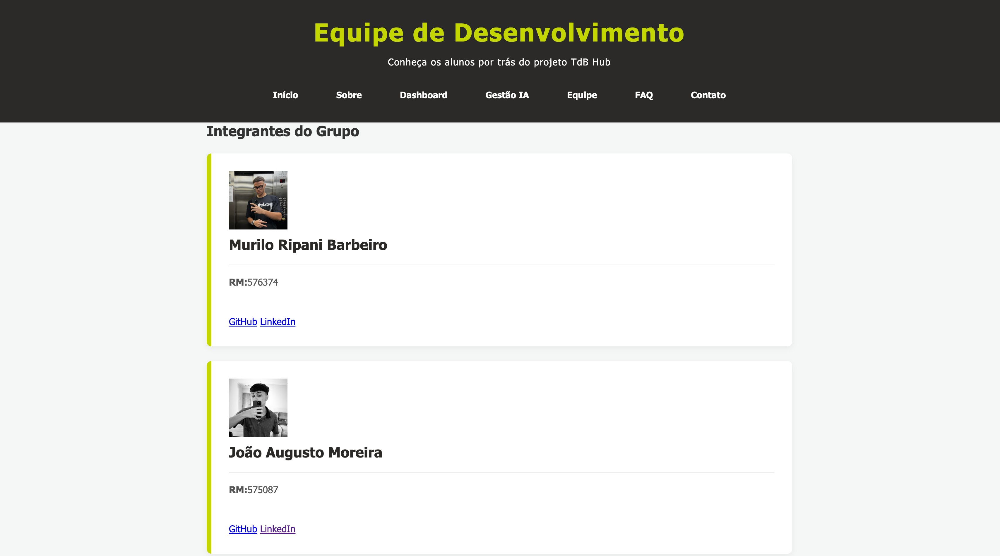
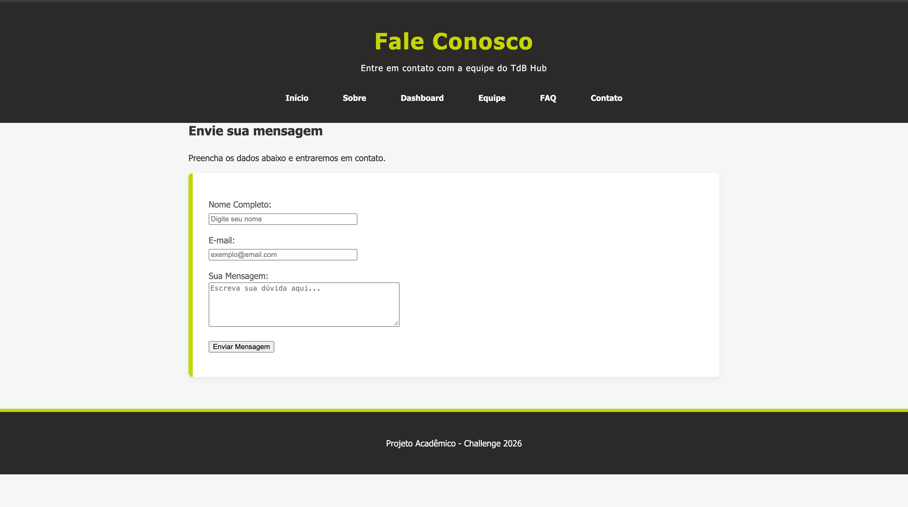

TdB Hub
Um hub centralizado e sistema de gestão projetado para otimizar fluxos de trabalho, consolidar o acesso a dados e aprimorar a colaboração da equipe nas operações.

# **Visão Geral do Projeto & Capturas de Tela**
O TdB Hub serve como um espaço de trabalho digital unificado para o desafio Turma do Bem na FIAP. Abaixo estão as prévias visuais da interface da aplicação e da arquitetura do sistema.

  

  

*Legenda: Visão geral da interface do painel principal e navegação da plataforma.*
Legenda: Visão geral da interface do painel principal e navegação da plataforma.
Tecnologias Utilizadas
O projeto utiliza tecnologias web fundamentais focadas em simplicidade, desempenho e acessibilidade:

HTML5: Estruturação semântica das páginas web
CSS3: Estilização moderna e layout responsivo
Estrutura de Pastas
tdb-hub/ 
├── css/ # Arquivos de estilização CSS 
├── imagens/ # Imagens e recursos visuais do projeto 
├── index.html # Página inicial 
├── sobre.html # Página sobre o projeto 
├── solucao-dashboard.html # Página do Dashboard 
├── solucao-ia.html # Página de Gestão IA 
├── integrantes.html # Página da equipe 
├── faq.html # Página de perguntas frequentes 
├── contato.html # Página de contato 
└── README.md # Documentação do projeto
# **Autores & Créditos**
| Foto | Nome | RM | Turma | Links |
| :--- | :--- | :--- | :--- | :--- |
|  | **Murilo Ripani Barbeiro** | 576374 | 1TDSPS-2026 | [LinkedIn](https://www.linkedin.com/in/murilo-ripani-900372368/) • [GitHub](https://github.com/muriloripani) |
|  | **João Augusto Moreira** | 575087 | 1TDSPS-2026 | [LinkedIn](https://www.linkedin.com/in/joão-augusto-12125b331/) • [GitHub](https://github.com/jaugustom0106-art) |
|  | **Bernardo Borges Franco** | 576078 | 1TDSPS-2026 | [LinkedIn](https://www.linkedin.com/in/bernardo-borges-2715212a1/) • [GitHub](https://github.com/borgexss328) |
|  | **Matheus Batista da Silva** | 574575 | 1TDSPS-2026 | [LinkedIn](https://www.linkedin.com/in/matheus-batista-da-silva-8b4ab2312/) • [GitHub](https://github.com/MatheusBatista1910) |

Repositório
Acesse o código-fonte oficial do projeto e o histórico de versões:

Repositório GitHub: https://github.com/muriloripani/tdb-hub
Contato & Suporte
Para dúvidas, feedbacks ou suporte em relação ao TdB Hub, entre em contato via:

Contato Principal: muribarbeiro@gmail.com

